*¿Que aprendi del curso?*
Concepto de Control de Versiones:La importancia fundamental de utilizar un Sistema de Control de Versiones (VCS) como Git, creado originalmente por Linus Torvalds en 2005, para administrar de forma limpia, segura y ordenada los cambios e historial de un proyecto de software a lo largo de su ciclo de vida.

Características Clave:La gestión eficiente de ramas (branches), la escalabilidad para proyectos grandes y el soporte robusto para la colaboración simultánea en equipo sobre un mismo código base.

Flujo de Trabajo Esencial: Se entendió cómo manejar proyectos con Git y GitHub, agregando archivos al área de preparación, realizando commits para guardar cambios y sincronizando todo con repositorios remotos.

Igual tome otro curso un poco mas largo donde aprendi a buscar los comandos y navegar desde la terminal por una carpeta, en ese tuve algunos problemas porque en un momento utilizo un comando que no reconocia mi terminal, asi que tuve que preguntar a Copilot y me explico que para mi terminal era distinto.

*¿Que comandos utilizaste?*

Paso 1: Verificar que la terminal funciona y su version:

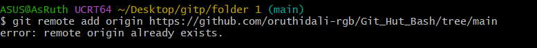

Paso 2:Realizar la credencial con el nombre y el email:

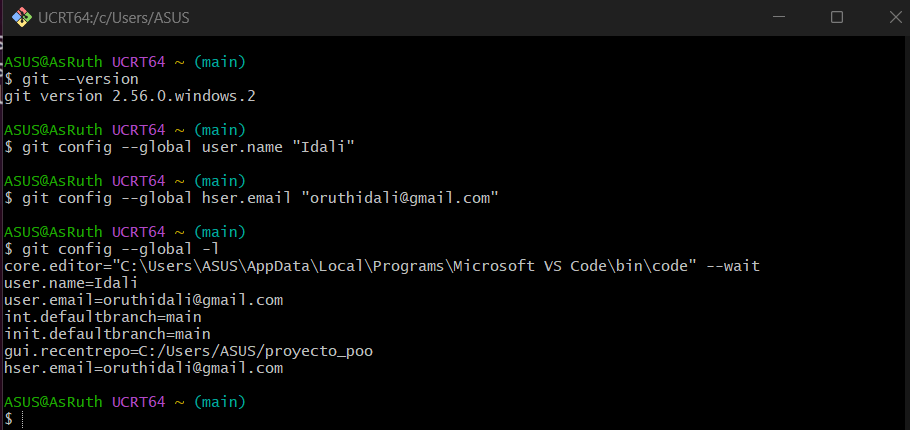

Paso 3:Acceder a la carpeta(No podiaaa):

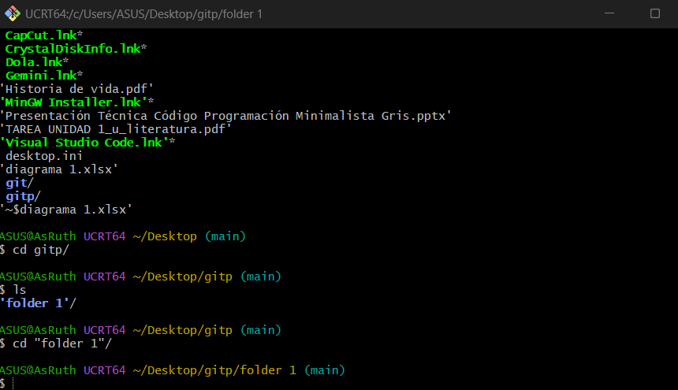

Paso 4:Inicializar el repositorio con Git init:

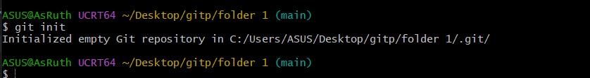

Paso 5:Visualizar los archivos ocultos:

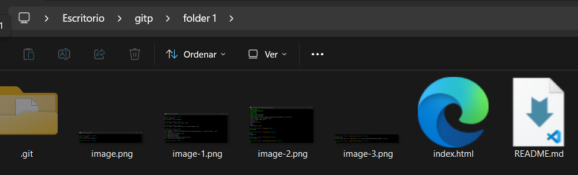

Paso 6:Verificar el estado de los archivos
    Para comprobar que Git detecta la carpeta, con el comando status:

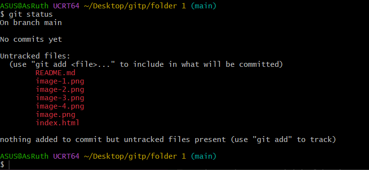

Paso 7:Preparar los archivos (Stage-listos para ser confirmados)
    Añadi todos los archivos de la carpeta actual al área de preparación con el comando add:

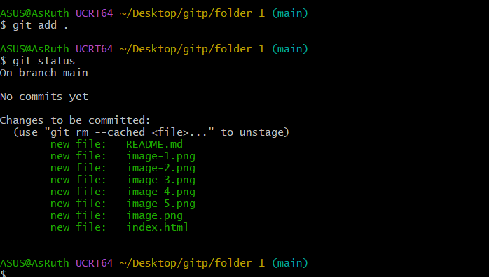

Paso 8:Guardar los cambios (commit)
     Primera instantánea del proyecto con un mensaje descriptivo con el comando commit -m:
     El comando git commit toma todos los archivos que estaban en esa zona de espera y les toma una instantánea o foto permanente en la historia de tu proyecto.

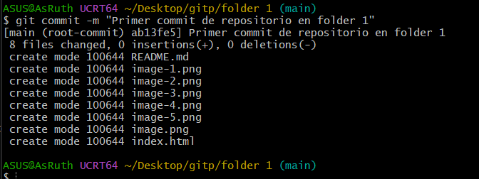

Dato :Cuando realizas un cambio en un archivo utilizas status para conocer que un archivo fue modificado:

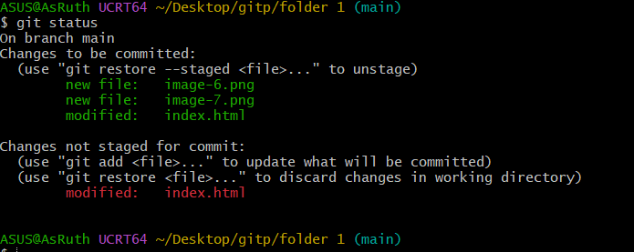

Dato 2 : Para conocer cual fue la modificacion utilizas diff:

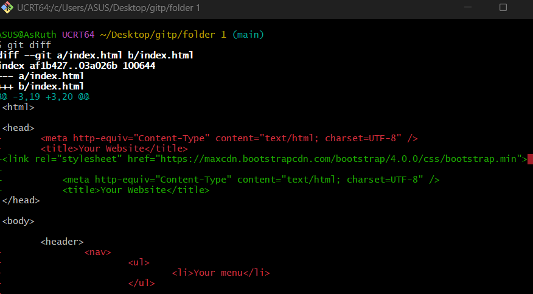

Dato 3: Para revertir la situacion al ultimo commit se utiliza checkout:

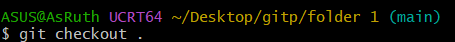

Modificaremos el titulo y revisaremos status:

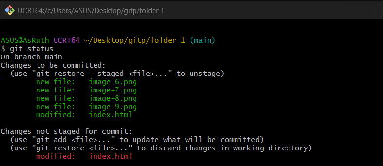

Colocamos add . para llevarlos a stage y un commit para guardar los cambios en el repoitorio:

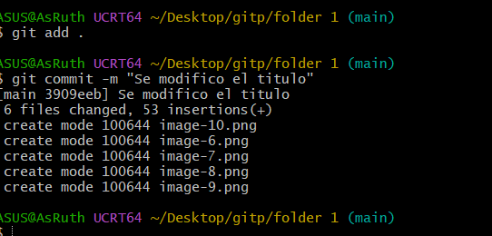

Para ver la lista de cambios con log:

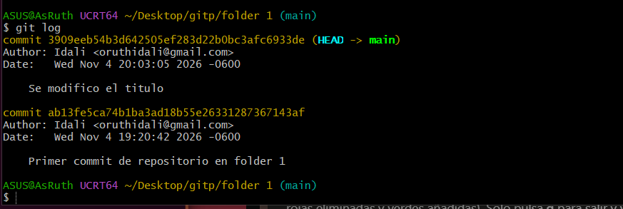

*STAGE Y LOGS*
-Para llevar el control unico de un archivo en repositorio se debe poner add y el nombre del archivo:

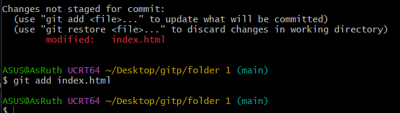

-Se realiza un commit para guardar los cambios:

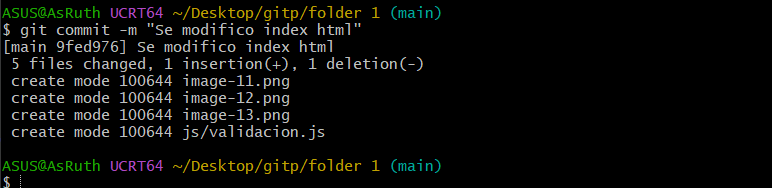

-Se añaden dos archivos en css:
--Se agrega con add nombre del archivo (css/*.css):

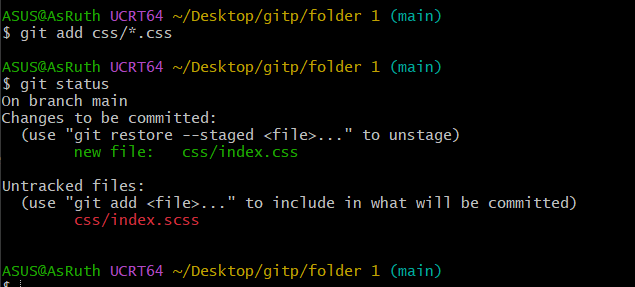

--Se agregan todos los archivos con add .

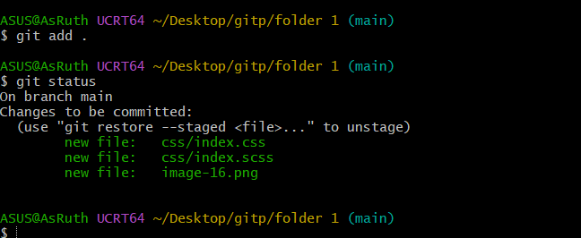

perooo...se quiere quitar un archivo del stage, enonces se utiliza reset nombre del archivo:

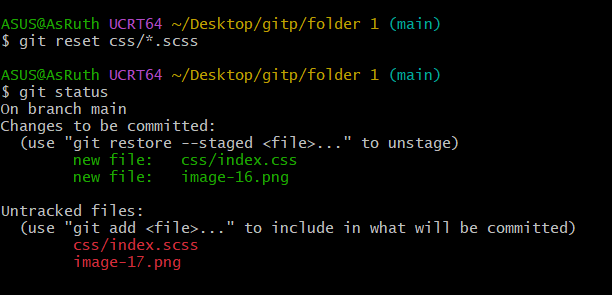

Para agregar de nuevo se puede utilizar add -A:

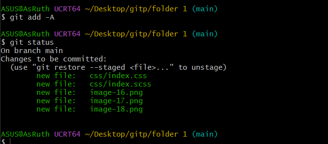

--exixte otra forma de quitar un archivo del stage y es similar:
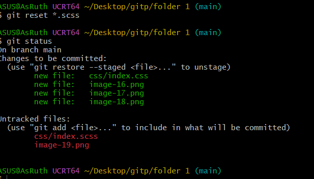

--para agregar de nuevo se realiza asi:

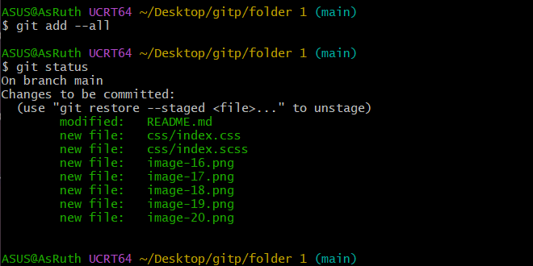

Dato 4: Para conocerlas definiciones de los comandos se utiliza git help commit:

*ALIAS*
Se crean alias para los comandos, como por ejemplo:

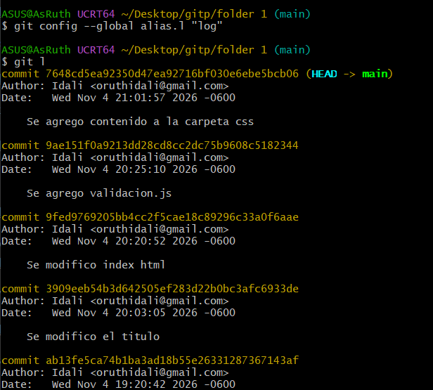

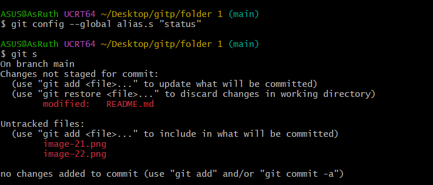

*MV/RM/reset*
*Como modifico el texto del commit al cometer un error:

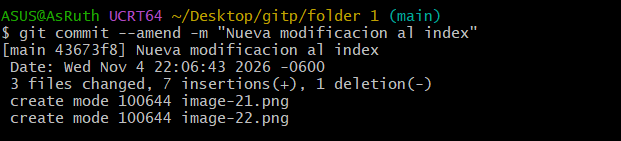

-para modificar el nombre del archivo debes colocar el comando mv,nombre del archivo y nuevo nombre:

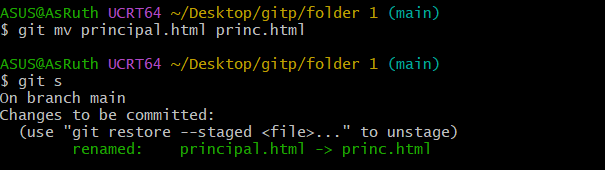

-para remover un archivo se utliza rm,nombre del archivo:

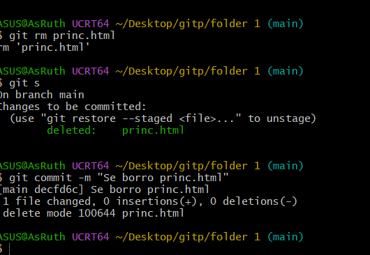

-para volver un paso atras se utiliza reset --soft y se pega el id:

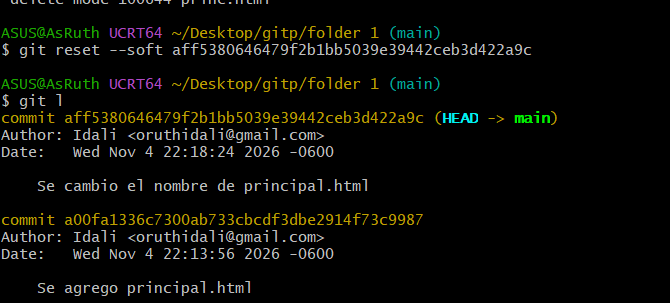

-para recuperar los archivos:

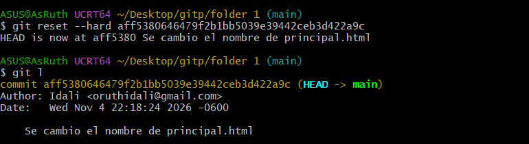

